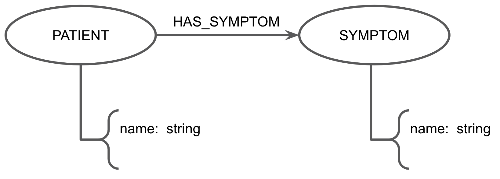
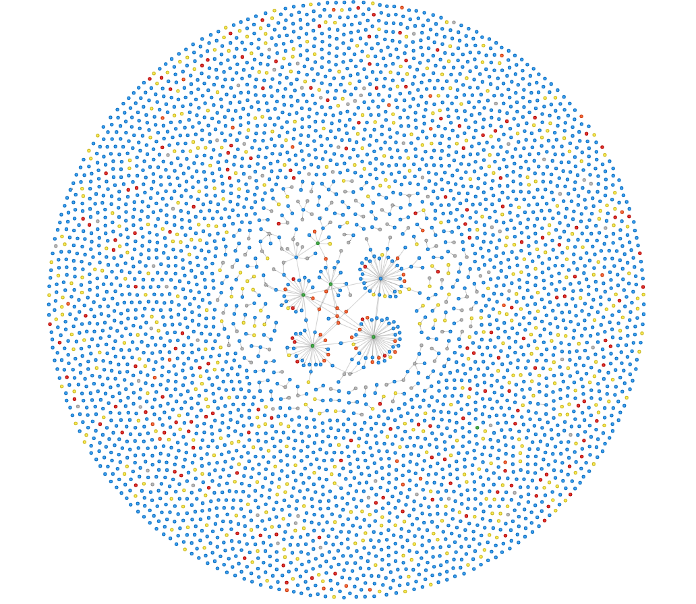
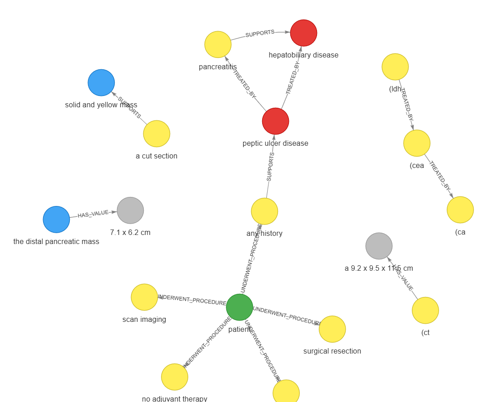

# Projeto Extração de Grafo de Conhecimento Clínico com Aprendizado de Máquina e N-gramas
# Project Clinical Knowledge Graph Extraction with Machine Learning and N-grams

## Slides

[Extração de Grafos de Casos Clínicos (Machine Learning) - NoLarPing.pdf](assets/slides/Extração%20de%20Grafos%20de%20Casos%20Clínicos%20(Machine%20Learning)%20-%20NoLarPing.pdf)

## Demonstração Executável

* **Visualização Interativa dos Grafos (HTML):** 
    * [knowledge_graph_pipeline1.html](assets/html/-knowledge_graph_pipeline1.html)
    
    * [knowledge_graph_pipeline2.html](assets/html/knowledge_graph_pipeline2.html)
* **Notebook Pipeline 1 (Weak Supervision + Rede Neural MLP):** [pipeline_rede_neural.ipynb](pipelines/pipeline1/pipeline_rede_neural.ipynb)
* **Notebook Pipeline 2 (N-gramas + Regressão Logística em Cascata):** [pipeline_ml_tradicional.ipynb](pipelines/pipeline2/pipeline_ml_tradicional.ipynb)
* **Notebook de Plotagem e Avaliação do Grafo:** [graph.ipynb](pipelines/graph/graph.ipynb)

## Metodologia

Para investigar como métodos estatísticos, representações baseadas em **N-gramas** e algoritmos de **Aprendizado de Máquina** (sem o uso de LLMs ou *embeddings* na inferência) podem superar ou complementar a extração baseada em regras do Projeto 1, a equipe desenvolveu e comparou **duas arquiteturas distintas de extração**:

### 1. Pipeline 1: Supervisão Fraca (*Weak Supervision*) e Rede Neural (MLP)

Esta abordagem investiga a hipótese de **Quantidade & Escala**: avaliar se uma rede neural consegue filtrar o ruído de uma base massiva gerada automaticamente por regras sintáticas e aprender os padrões reais do domínio clínico.

* **Fase 1 (Padronização e Expansão):** Expandimos o extrator determinístico do Projeto 1 (`projeto1_modificado.ipynb`) utilizando Regex, spaCy/scispaCy e *Matchers* sintáticos para rotular automaticamente milhares de pares de entidades na base MultiCaRe. Os dados foram estruturados em triplas padronizadas contendo a entidade de origem (`e1_text`, `e1_type`), entidade de destino (`e2_text`, `e2_type`), o contexto textual entre elas (`intermediate_text`) e a relação alvo (`relation_label`), incluindo a classe negativa `NO_RELATION`.
* **Fase 2 (Feature Engineering com TF-IDF e N-gramas):** Extraímos apenas o `intermediate_text` (texto localizado entre as duas entidades candidatas), sob a premissa estatística de que o gatilho semântico da relação médica reside nesse intervalo (ex: *"treated with"*, *"revealed a"*). Aplicamos vetorização **TF-IDF** combinada com **unigramas e bigramas** (e N-gramas de caracteres/sub-palavras), silenciando palavras comuns e amplificando conectivos clínicos decisivos.
* **Fase 3 (Treinamento da MLP e o Problema da "Rede Preguiçosa"):** Treinamos uma rede *Multi-Layer Perceptron* (MLP) em PyTorch para classificar as relações. Devido ao severo desbalanceamento das classes (predominância de `NO_RELATION`), a rede inicialmente comportava-se de maneira "preguiçosa", atingindo 87% de acurácia na primeira época apenas chutando a classe majoritária. Solucionamos isso aplicando uma **penalização agressiva na Função de Perda (*Cross-Entropy Loss*)**, utilizando pesos inversamente proporcionais à frequência das classes elevados à quinta potência:

~~~python
# Cálculo de pesos agressivos para combater o desbalanceamento na Loss Function
class_counts = np.bincount(y_train)
class_weights = (1.0 / (class_counts + 1e-5)) ** 5
class_weights = class_weights / class_weights.sum() * len(class_counts)
criterion = nn.CrossEntropyLoss(weight=torch.FloatTensor(class_weights).to(device))
~~~

### 2. Pipeline 2: Anotação Refinada e Regressão Logística em Cascata (*Stacking*)

Esta abordagem investiga a hipótese de **Qualidade > Quantidade**, treinando modelos lineares clássicos em uma base menor, porém com anotações de alta precisão (`text01.csv` a `text12.csv`), dividindo a tarefa em dois modelos sequenciais (`useful/preprocess.py` e `useful/train.py`):

* **Pré-processamento e Vetorização:** Lematização via spaCy, remoção de pontuação e *stopwords*, seguida pela extração de janelas de **N-gramas de 1 a 5 tokens** (`ngram_range=(1, 5)`, `max_features=2000`) ponderados por **TF-IDF**. Isso permite capturar tanto entidades compostas (*"mucinous pancreatic cystic neoplasm"*) quanto locuções relacionais longas.
* **Modelo 1 (Classificador de Entidades):** Recebe a string candidata e utiliza **Regressão Logística** (`C=0.5`, `max_iter=1000`) para predizer o tipo do nó (`PATIENT`, `SYMPTOM`, `DIAGNOSIS`, `FINDING`, `PROCEDURE`, `VALUE` ou a classe de descarte `NOT_ENTITY`).
* **Modelo 2 (Classificador de Relações via *Stacking*):** Recebe as predições de tipo da Entidade 1 e da Entidade 2 vindas do Modelo 1 (codificadas via *One-Hot Encoding*) empilhadas (*Stacking*) com o vetor TF-IDF de N-gramas do `intermediate_text`. Uma segunda **Regressão Logística** classifica a aresta entre as 5 relações válidas ou `NO_RELATION`.

~~~python
# Vetorização por N-gramas (1 a 5) e empilhamento de features (Stacking) no Modelo 2
vectorizer = TfidfVectorizer(ngram_range=(1, 5), max_features=2000)
X_text_tfidf = vectorizer.fit_transform(df['intermediate_text_clean'])
X_combined = hstack([e1_onehot, X_text_tfidf, e2_onehot])

clf_relation = LogisticRegression(C=0.5, max_iter=1000)
clf_relation.fit(X_combined, y_relations)
~~~

### Confronto com Trabalho Anterior

Para realizar um confronto experimental rigoroso e livre de vazamento de dados (*data leakage*), construímos um conjunto de teste isolado (**Gold Standard**, arquivos `gold01.csv` a `gold03.csv`, totalizando 125 instâncias de relações clínicas reais). Comparamos diretamente o **Projeto 1 (Regras Sintáticas)** contra a **Pipeline 1 (MLP)** e a **Pipeline 2 (Regressão Logística)**:

| Abordagem / Modelo | Precision (Macro) | Recall (Macro) | Macro-F1 (5 Classes Válidas) | Comportamento Observado |
| :--- | :---: | :---: | :---: | :--- |
| **Projeto 1 (Regras Sintáticas)** | 0,60 | 0,08 | **0,133** | **Alta precisão, baixíssimo recall:** Acerta quando encontra o padrão exato no dicionário, mas falha em generalizar para termos fora das listas fixas. |
| **Pipeline 1 (MLP + *Weak Supervision*)** | — | — | **0,454** | **Ganho expressivo de cobertura:** A rede neural conseguiu abstrair parte do ruído das regras e triplicou o F1-Score em relação ao Projeto 1. |
| **Pipeline 2 (Regressão Logística + N-gramas)** | — | — | **0,651** | **Melhor desempenho geral:** A combinação de N-gramas (até $n=5$) com dados de treino limpos e *Stacking* de tipos de entidade superou todas as abordagens. |

## Trabalhos Estudados

* **Nievas Offidani et al. (2025) — *MultiCaRe Dataset*:** Base fundamental dos relatos clínicos extraídos do PubMed Central utilizados para treinamento e teste.
* **Ji et al. (2022) — *A Survey on Knowledge Graphs*:** Fundamentação teórica para a modelagem de extração de relações (Relation Extraction) e construção topológica do grafo.
* **Jurafsky & Martin (2026) — *Speech and Language Processing (CS 124)*:** Base conceitual para o uso de probabilidades condicionais em N-gramas na captura de conhecimento sintático clínico (ex: $P(\text{with} \mid \text{treated})$) e semântico (entidades compostas).

## Modelo Lógico

No Projeto 2, refinamos a granularidade semântica dos nós para refletir melhor o raciocínio diagnóstico médico, mantendo as 5 relações estruturais do grafo:

* **Tipos de Nós (Entidades):**
  * `PATIENT`: Paciente central do relato (ex: *44-year-old woman*).
  * `SYMPTOM`: Sintomas relatados (ex: *abdominal pain*, *nausea*).
  * `DIAGNOSIS`: Diagnósticos confirmados ou patologias (ex: *gastric duplication cyst*).
  * `FINDING`: Achados clínicos ou anatômicos em exames (ex: *cyst*, *mucosal abnormality*).
  * `PROCEDURE`: Exames laboratoriais, de imagem e cirurgias (ex: *computed tomography*, *EUS-FNA*).
  * `VALUE`: Medidas quantitativas e dosagens (ex: *6 cm*, *12,476.5 ng/ml*).
* **Tipos de Arestas (Relações):** `HAS_SYMPTOM`, `UNDERWENT_PROCEDURE`, `SUPPORTS`, `TREATED_BY` e `HAS_VALUE`.

## Análises que podem ser realizadas

Com a transição para o Aprendizado de Máquina, o grafo gerado permite análises muito mais ricas sobre o corpus do MultiCaRe:

* **Descoberta de Entidades e Sintomas Fora de Vocabulário (OOV):** Diferente do Projeto 1, que dependia de listas manuais (`disease_keywords`), o modelo baseado em N-gramas de contexto e TF-IDF consegue inferir que um termo inédito é um sintoma ou achado clínico apenas pelos N-gramas que o cercam (ex: precedido por *"presented with a history of"*).
* **Análise de Gargalos por Classe Relacional:** Avaliando as métricas por classe no *Gold Standard*, identificamos quais relações possuem estrutura sintática mais regular na literatura médica (como `SUPPORTS` e `HAS_VALUE`) e quais exigem maior volume de exemplos para aprendizado (como `TREATED_BY`).
* **Clusterização de Comorbidades e Trajetórias Clínicas:** A padronização das predições permite visualizar agrupamentos de sintomas e a cadeia probatória de exames que sustentam (`SUPPORTS`) um diagnóstico final.

## Ferramentas

* **Scikit-Learn (`TfidfVectorizer`, `LogisticRegression`, `OneHotEncoder`):** Pilar da Pipeline 2 e da etapa de *Feature Engineering*, responsável pela extração de N-gramas, ponderação estatística TF-IDF, empilhamento de matrizes esparsas e classificação linear.
* **PyTorch (`torch.nn`, `DataLoader`):** Utilizado na Pipeline 1 para construção, treinamento acelerado e customização da função de perda ponderada da rede neural MLP.
* **spaCy & NLTK:** Utilizadas no pré-processamento linguístico (tokenização, lematização, segmentação de sentenças e remoção de *stopwords*).
* **Pandas, NumPy & SciPy:** Manipulação tabular, alinhamento de matrizes de anotações e cálculo de métricas de avaliação.
* **PyVis:** Geração da visualização interativa em rede HTML com simulação física (*ForceAtlas2*).

## Resultados

A avaliação experimental nas 125 instâncias do *Gold Standard* demonstrou a superioridade incontestável dos métodos baseados em N-gramas e Aprendizado de Máquina sobre as regras rígidas do Projeto 1:

1. **Desempenho Global (Macro-F1):** O Projeto 1 obteve **0,133** de Macro-F1, penalizado pelo seu baixíssimo *recall* (0,08). A Pipeline 1 (MLP com supervisão fraca) elevou o Macro-F1 para **0,454**, provando que redes neurais conseguem extrair sinal útil mesmo de dados ruidosos quando devidamente regularizadas na função de perda. A **Pipeline 2 (Regressão Logística)** atingiu o melhor resultado, com **0,651** de Macro-F1.
2. **Desempenho por Classe:**
   * Nas classes `HAS_SYMPTOM`, `HAS_VALUE` e `SUPPORTS`, ambos os modelos de ML tiveram excelente desempenho, com a Pipeline 2 atingindo F1-Score entre **0,80 e 0,92**.
   * Na classe `UNDERWENT_PROCEDURE`, apenas a Pipeline 2 conseguiu generalizar os padrões no conjunto de teste, alcançando **F1 $\approx$ 0,67**.
   * Na classe `TREATED_BY`, nenhum dos modelos obteve acerto no conjunto de teste devido à extrema raridade dessa relação na amostra avaliada (poucos exemplos de suporte).
3. **Qualidade vs. Quantidade:** O experimento comprovou empiricamente que um conjunto menor de dados bem anotados combinando `TfidfVectorizer(ngram_range=(1,5))` e *Stacking* de entidades (Pipeline 2) supera um grande volume de dados gerados por supervisão fraca ruidosa (Pipeline 1).

## Como Modelos de Linguagem foram Usados

Em estrita conformidade com as regras da disciplina, **nenhum Large Language Model (LLM), Transformer ou modelo de *embeddings* foi utilizado dentro das pipelines de extração ou inferência**. Os LLMs foram utilizados exclusivamente como ferramentas de apoio externo nas seguintes tarefas:

* **Simulação de Anotador Especialista (*Gold Standard* e Treino da Pipeline 2):** Para viabilizar a criação de um gabarito clínico de referência sem o custo financeiro de contratar profissionais de saúde humanos, utilizamos o **Google Gemini 3.1 Pro** offline para anotar 15 casos clínicos (`data/annotations/`), gerando os rótulos de referência (incluindo classes negativas `NOT_ENTITY` e `NO_RELATION`) que serviram para treinar a Regressão Logística e avaliar os três modelos de forma justa no *Gold Standard*.
* **Auxílio em Código de Visualização e Documentação:** Suporte na estilização da interface gráfica do PyVis, geração de gráficos comparativos no Matplotlib e revisão estrutural dos slides.

## Referências Bibliográficas

* Nievas Offidani, M., Roffet, F., González Galtier, M. C., Massiris, M., & Delrieux, C. (2025). *An Open-Source Clinical Case Dataset for Medical Image Classification and Multimodal AI Applications*. Data 2025, 10(8), 123. https://doi.org/10.3390/DATA10080123
* Ji, S., Pan, S., Cambria, E., Marttinen, P., & Yu, P. S. (2022). *A Survey on Knowledge Graphs: Representation, Acquisition, and Applications*. IEEE Transactions on Neural Networks and Learning Systems, 33(2), 494–514. https://doi.org/10.1109/TNNLS.2021.3070843
* Jurafsky, D., & Martin, J. H. (2026). *Speech and Language Processing* (3rd ed. draft) / CS 124: From Languages to Information. Stanford University. https://web.stanford.edu/class/cs124/