# Projeto Extração de Grafo de Conhecimento Clínico do MultiCaRe: Regras, N-gramas e Aprendizado de Máquina
# Project MultiCaRe Clinical Knowledge Graph Extraction: Rules, N-grams and Machine Learning

> **Equipe:** `<preencher: nomes e RAs>`

## Slides

`<preencher: link para assets/slides/<arquivo>.pdf no GitHub>`

## Demonstração Executável

- **Um comando** (Linux, macOS ou Windows), a partir de `project2/`: `python3 run.py`. Ele cria o ambiente (Python 3.12), instala as dependências, roda todas as etapas, atualiza as tabelas deste README e abre o painel. Detalhes em [`src/README.md`](src/README.md).
- **Painel interativo** [`assets/html/index.html`](assets/html/index.html) (abrir no navegador): grafo do gold sobreposto ao de cada modelo, com filtros por status (certa, rótulo errado, a mais, perdida) e por relação, busca, detalhes com o trecho do texto clínico, tabela de arestas, grafo do corpus e todas as métricas.
- Notebook de demonstração: [`pipelines/notebooks/demo_comparacao.ipynb`](pipelines/notebooks/demo_comparacao.ipynb)
  · Colab: `https://colab.research.google.com/github/<usuario>/MC896-NLP/blob/main/project2/pipelines/notebooks/demo_comparacao.ipynb` `<preencher usuário>`

## Metodologia

O Projeto 2 parte das regras do Projeto 1 (P1) e investiga **onde** o aprendizado estatístico e os n-gramas ajudam a extrair o grafo. Três extratores são comparados contra um gold standard anotado à mão, e os n-gramas aparecem em quatro pontos do processo.

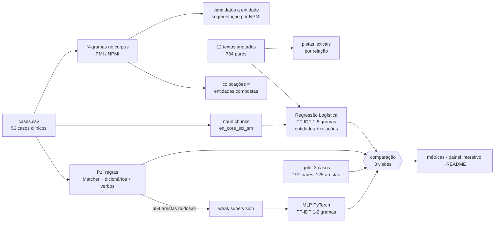

**Extratores comparados**

| Modelo | Supervisão | Entrada | Saída |
|---|---|---|---|
| **P1** (regras) | nenhuma (regras escritas à mão) | texto | entidades tipadas por dicionário + arestas por lema de verbo |
| **LR** | 12 textos anotados manualmente (784 pares) | noun chunks + texto intermediário (TF-IDF de n-gramas 1–5, lematizado) + tipos | tipo da entidade; relação ou `NO_RELATION` |
| **LR_TEXTO** (variante) | os mesmos 12 textos | só o texto intermediário (tipos trocados por constante) | relação ou `NO_RELATION`; comparável direto do MLP |
| **MLP** | arestas do P1 (*weak supervision*, 620 arestas de 53 casos) | texto intermediário (TF-IDF 1–2) | 4 relações (as que o P1 produz) |
| **TIPOS** (referência) | maioria por par de tipos nos 12 textos | só `(e1_type, e2_type)` | relação |

**Três visões de comparação**, para separar o que cada componente faz:

1. **Tipagem de entidade dado o span**: os mesmos spans do gold são tipados pelos dicionários do P1 e pelo classificador de n-gramas do LR. É a comparação regras × aprendizado mais justa, porque a entrada é idêntica.
2. **Relação dado o par**: o par e os tipos vêm do gold, e só o rótulo é predito. Entram TIPOS, P1_TABELA (a tabela tipo→rótulo implícita nas regras do P1), LR, LR_TEXTO e MLP. As 66 linhas `NO_RELATION` do gold medem **falsos alarmes**.
3. **Ponta a ponta**: P1 e LR extraem do texto os próprios pares. O casamento com o gold é por sobreposição de tokens (Jaccard ≥ 0,5 ou contenção, com todo PATIENT unificado). Medimos cobertura, acerto de rótulo e de tipos, precisão (limite inferior), a razão |predito|/|gold| (excesso × perda) e a estrutura do grafo.

Trecho central do casamento ponta a ponta (`src/comparison/match.py`):

~~~python
def entity_sim(a: frozenset, b: frozenset) -> float:
    jac = len(a & b) / len(a | b)
    if jac >= JACCARD_MIN or a <= b or b <= a:   # Jaccard >= 0,5 ou contenção
        return max(jac, 0.5)
    return 0.0
~~~

**Onde estão os n-gramas**

| Uso | Onde | O que responde |
|---|---|---|
| Features TF-IDF 1–5 (LR) e 1–2 (MLP) | `pipelines/` | classificação de entidades e relações |
| Colocações por PMI/NPMI no corpus | `src/ngrams/collocations.py` | entidades compostas e associações entre termos (`computed tomography`, `pleural effusion`) |
| Pistas lexicais por relação (PMI n-grama × rótulo) | `src/ngrams/relation_cues.py` | nomes compostos de relação (`presented with`, `revealed`, `underwent`) aprendidos sem regra |
| Segmentação por NPMI como gerador de candidatos | `src/ngrams/candidates.py` | n-gramas encontram entidades melhor que cortar em stopwords? |
| Coeficientes e ablação do `ngram_range` | `src/ngrams/lr_features.py` | o que a LR aprendeu; n-gramas maiores ajudam? |

### Confronto com Trabalho Anterior

A comparação com o P1 é **experimental**, nas três visões acima (tabelas em [Resultados](#resultados)). Os achados que orientam a leitura dos números são os seguintes.

- **No nosso esquema, o rótulo da relação é função dos tipos das entidades.** O baseline TIPOS, que só olha `(e1_type, e2_type)`, acerta as linhas positivas do gold. Logo, na visão "dado o par" com tipos corretos, a relação é trivial, e um modelo que recebe os tipos (LR) parece perfeito *por causa dos tipos*, não dos n-gramas. Por isso a comparação regras × aprendizado que importa é a **tipagem de entidades** (visão 1), junto com a **ponta a ponta** (visão 3). A figura `lr_massa_tipos_texto.png` mostra quanto do peso da LR de relação está nas features de tipo, e a variante LR_TEXTO mede o que o texto sozinho recupera, nas mesmas condições do MLP (manual × *weak supervision*, ambos só com texto).
- **Um bug de uma linha do P1 virou um ponto cego do MLP.** A regra de `UNDERWENT_PROCEDURE` filtra `node_type == 'EXAM'`, mas o P1 gera o tipo `PROCEDURE`. A regra nunca dispara, o `edges.csv` não tem essa classe e o MLP (*weak supervision*) nunca a prevê. O mesmo vale para `TREATED_BY` sem filtro de tipo: 127 das 148 arestas `TREATED_BY` do P1 são `PATIENT→FINDING`. A *weak supervision* herda os vícios das regras.
- **O MLP não sabe dizer "não há relação".** Ele foi treinado só com arestas positivas, então cria uma aresta em todo par que recebe (ver falsos alarmes). Esse é o "excesso de relações" de que fala o guia.
- **O P1 tem cobertura baixa por construção.** Ele gera só 34 arestas nos 3 casos do gold, contra 125 arestas no gold. A regra `SUPPORTS` liga só os dois primeiros nós de cada sentença, e os nós são deduplicados por caso.
- **Negação: convenções diferentes.** O P1 *descarta* entidades precedidas de negação ("no", "denied", "without"…). O gold *mantém* a aresta: "Patient — denied any history of → pancreatitis" está anotado como `HAS_SYMPTOM`. A coluna `negated` (descritiva) mostra quantas arestas de cada grafo afirmam algo que o texto nega. A análise de pistas confirma o padrão: `denied` aparece entre as pistas de `HAS_SYMPTOM` aprendidas dos textos de treino.

## Trabalhos Estudados

> Todas as referências abaixo devem ter os dados bibliográficos conferidos antes da entrega.

- **Supervisão distante e *weak supervision*.** Mintz et al. (2009) propuseram rotular relações automaticamente a partir de uma base de conhecimento, aceitando ruído. Ratner et al. (2017, Snorkel) formalizaram a combinação de várias fontes fracas de rótulo. Nosso MLP é o caso mais simples: **uma** fonte fraca (as regras do P1), sem modelar o ruído. Os resultados mostram o efeito previsto pela literatura: o modelo reproduz o viés da fonte.
- **Colocações e PMI.** Church & Hanks (1990) introduziram a informação mútua pontual para associação lexical. Manning & Schütze (1999, cap. 5) comparam frequência, PMI e testes de hipótese para extrair colocações. Bouma (2009) propõe o PMI normalizado (NPMI), menos viesado para pares raros, viés que observamos no nosso corpus de 56 casos.
- **Negação em texto clínico.** O NegEx (Chapman et al., 2001) detecta achados negados com gatilhos lexicais e janelas, a mesma ideia da lista de negação do P1. A coluna `negated` usa essa lista.
- **Extração de relações clínicas.** O desafio i2b2/VA 2010 (Uzuner et al., 2011) definiu conceitos, asserções (incluindo negação) e relações entre problema, tratamento e teste. Nosso esquema é parecido, mas sem a camada de asserção, e isso explica a divergência de negação acima.
- **Ferramentas e dados.** scispaCy (Neumann et al., 2019) para sentenças, noun chunks e lemas; MultiCaRe (Nievas Offidani & Delrieux, 2024) como corpus; Jurafsky & Martin (SLP3, cap. 3) para modelos de n-gramas.

## Modelo Lógico

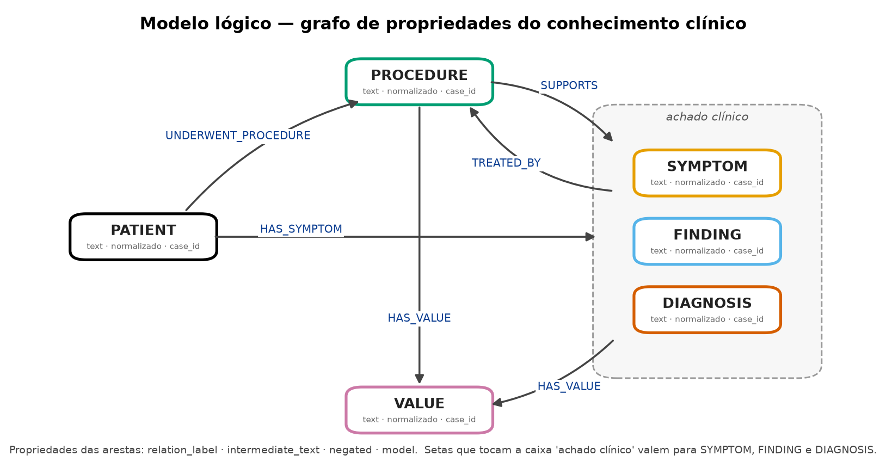

Nós: `PATIENT`, `PROCEDURE`, `SYMPTOM`, `FINDING`, `DIAGNOSIS`, `VALUE`, com as propriedades `text`, `normalizado` e `case_id`. Arestas: `UNDERWENT_PROCEDURE`, `HAS_SYMPTOM`, `SUPPORTS`, `TREATED_BY` e `HAS_VALUE`, com as propriedades `relation_label`, `intermediate_text`, `negated` e `model` (qual extrator criou a aresta). A figura é gerada por `src/graph/logical_model.py`.

## Análises que podem ser realizadas

- **Hubs por caso e no corpus:** quais achados e procedimentos concentram arestas (aba "Grafo do corpus" do painel, nós dimensionados pelo grau e filtro por grau mínimo).
- **Caminhos sintoma → exame → achado → valor:** reconstruir a linha diagnóstica de um caso (`PATIENT -HAS_SYMPTOM-> X`, `PROCEDURE -SUPPORTS-> X`, `X -HAS_VALUE-> VALUE`).
- **Coocorrência entre casos:** achados e diagnósticos que aparecem juntos em vários pacientes (colocações por NPMI como sinal de associação).
- **Qualidade do grafo por extrator:** excesso × perda de arestas, proporção de arestas negadas e dependência do nó PATIENT (tabela "estrutura dos grafos").

## Ferramentas

- **Python 3.12**, pandas, scikit-learn (TF-IDF, Regressão Logística, métricas), PyTorch (MLP), networkx (estrutura e layout dos grafos) e matplotlib (figuras com uma cor fixa por modelo).
- **spaCy 3.7** (versão com que o `en_core_sci_sm` 0.5.4 foi treinado) com `en_core_web_sm` (P1) e `en_core_sci_sm` (pipeline2), usados só para sentenças, noun chunks, POS e lemas. Nenhum dos dois traz vetores de palavras pré-treinados: `vocab.vectors.shape` é `(0, 0)`, verificado a cada execução por `src/check_env.py`. O tagger e o parser usam uma CNN própria, não um Transformer. O ambiente é fixo (Python 3.12, spaCy 3.7, NumPy < 2) porque o `en_core_sci_sm` 0.5.4 só carrega com spaCy 3.7.
- **vis-network** (via CDN) no painel interativo e **PyVis** no notebook legado de visualização.
- **Jupyter / VS Code** para os pipelines; `src/` para o sistema de comparação, executável fora do notebook; `run.py` para criar o ambiente e rodar tudo; **uv** para instalar o Python 3.12.

## Resultados

Figuras (geradas por `python3 run.py`; as mesmas aparecem na aba "Métricas" do painel):

| | |
|---|---|
| 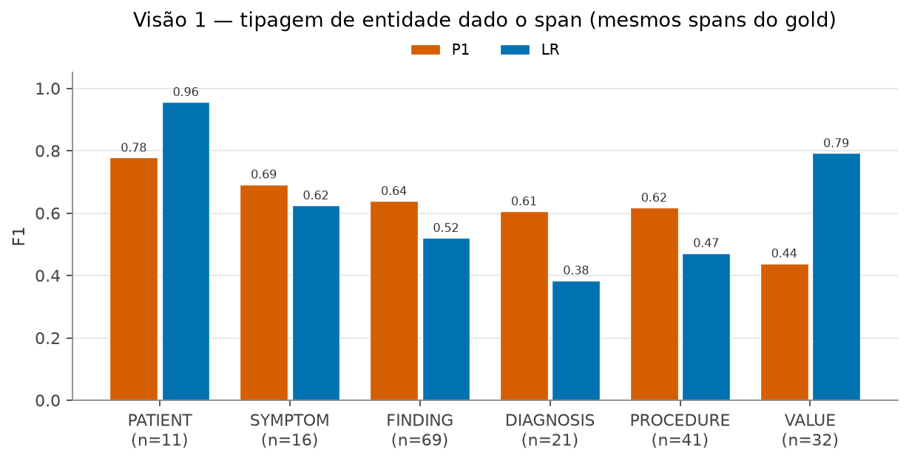 | 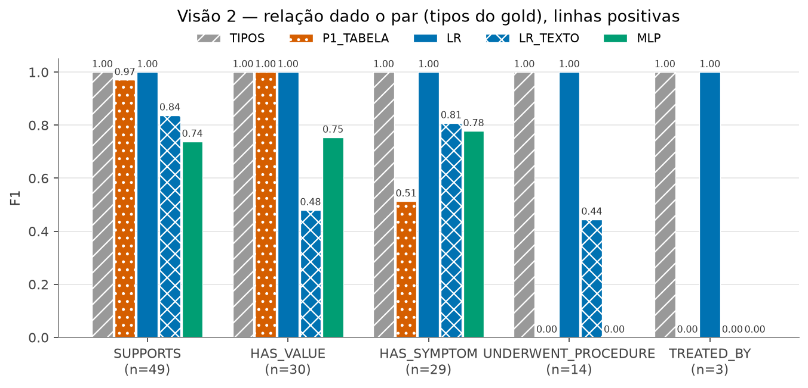 |
| 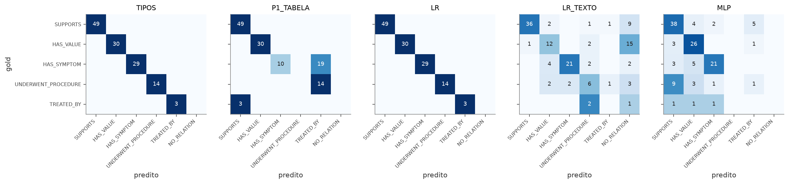 | 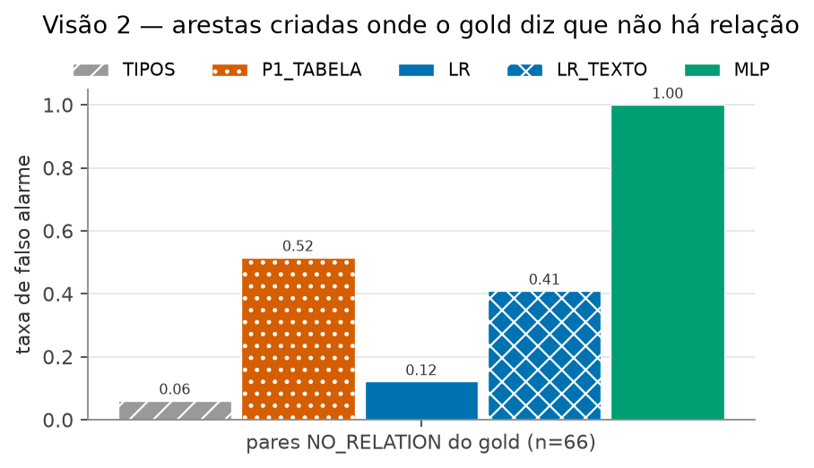 |
| 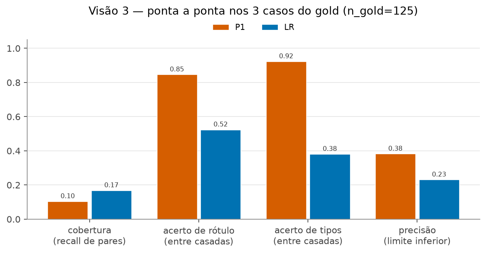 | 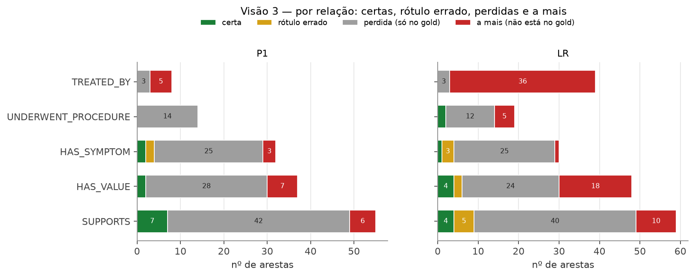 |
| 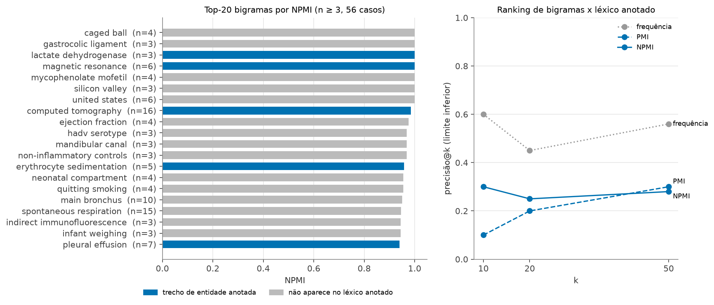 | 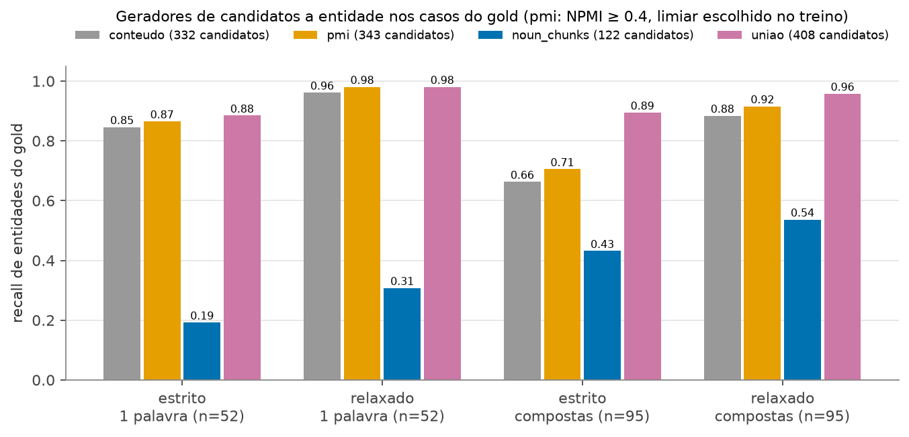 |
| 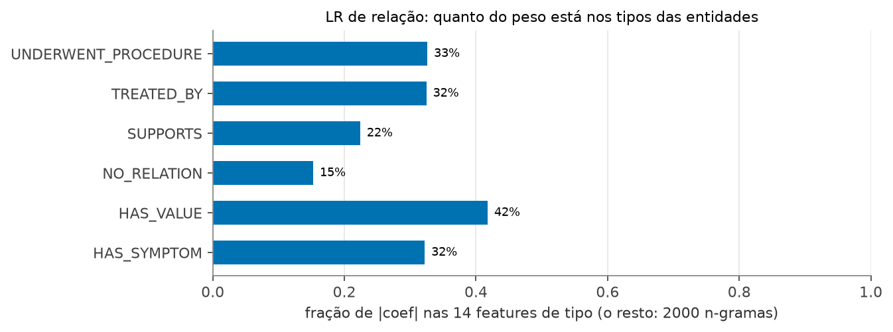 | 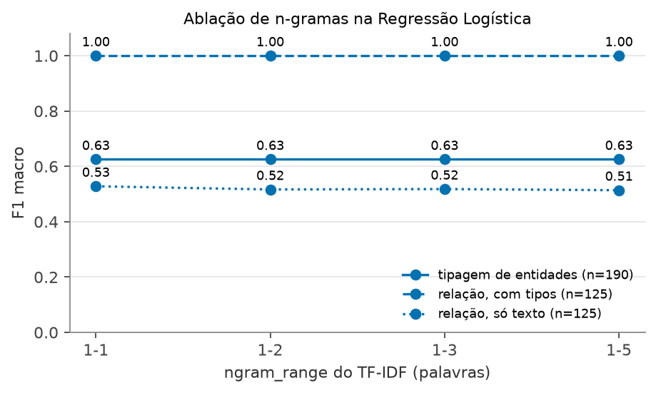 |

**Grafos:** a comparação gold × modelo é feita no **painel interativo** ([`assets/html/index.html`](assets/html/index.html)), porque uma imagem estática com dezenas de arestas fica ilegível. Lá dá para escolher o caso e o modelo e filtrar por status (verde = certa, âmbar = rótulo errado, vermelho = a mais, cinza tracejado = perdida) e por relação. Também dá para ocultar o nó PATIENT, que concentra as arestas, e clicar em nós e arestas para ver o contexto e o trecho do texto clínico. A figura `v3_e2e_status_por_relacao.png` resume a mesma informação de forma estática.

**Tabelas** (inseridas automaticamente por `src/report.py`; não editar à mão entre os marcadores):

<!-- RESULTADOS:INICIO -->

### Visão 1 — entidades

#### Tipagem de entidade dado o span (F1 por tipo)

| classe | n | P1 | LR |
|---|---|---|---|
| PATIENT | 11 | 0.78 | 0.96 |
| SYMPTOM | 16 | 0.69 | 0.62 |
| FINDING | 69 | 0.64 | 0.52 |
| DIAGNOSIS | 21 | 0.61 | 0.38 |
| PROCEDURE | 41 | 0.62 | 0.47 |
| VALUE | 32 | 0.44 | 0.79 |
| macro | 190 | 0.63 | 0.63 |
| acurácia | 190 | 0.62 | 0.56 |

P1 = dicionários de palavras-chave; LR = Regressão Logística com n-gramas 1–5. Mesmos spans do gold (sem NOT_ENTITY). Na linha 'acurácia', a coluna do modelo é a acurácia.

### Visão 2 — relação dado o par

#### F1 por classe, tipos do gold, só linhas positivas

| classe | n | TIPOS | P1_TABELA | LR | LR_TEXTO | MLP |
|---|---|---|---|---|---|---|
| SUPPORTS | 49 | 1.00 | 0.97 | 1.00 | 0.84 | 0.74 |
| HAS_VALUE | 30 | 1.00 | 1.00 | 1.00 | 0.48 | 0.75 |
| HAS_SYMPTOM | 29 | 1.00 | 0.51 | 1.00 | 0.81 | 0.78 |
| UNDERWENT_PROCEDURE | 14 | 1.00 | 0.00 | 1.00 | 0.44 | 0.00 |
| TREATED_BY | 3 | 1.00 | 0.00 | 1.00 | 0.00 | 0.00 |
| macro | 125 | 1.00 | 0.50 | 1.00 | 0.51 | 0.45 |
| acurácia | 125 | 1.00 | 0.71 | 1.00 | 0.60 | 0.68 |

TIPOS = baseline que só olha (e1_type, e2_type). LR_TEXTO = a mesma LR sem os tipos (comparável ao MLP, que também só vê texto). Se TIPOS empata com a LR, a relação está sendo decidida pelos tipos.

#### Falsos alarmes nos pares NO_RELATION do gold

| modelo | n_negativos | falsos_alarmes | taxa | prediz_no_relation |
|---|---|---|---|---|
| TIPOS | 66 | 4 | 0.06 | True |
| P1_TABELA | 66 | 34 | 0.52 | True |
| LR | 66 | 8 | 0.12 | True |
| LR_TEXTO | 66 | 27 | 0.41 | True |
| MLP | 66 | 66 | 1.00 | False |

MLP não tem a classe NO_RELATION: toda predição dele é uma aresta.

#### Acurácia por caso (variação entre os 3 casos)

| modelo | PMC11131390_01 | PMC11722600_01 | PMC3859158_01 |
|---|---|---|---|
| TIPOS | 1.00 | 1.00 | 1.00 |
| P1_TABELA | 0.61 | 0.90 | 0.64 |
| LR | 1.00 | 1.00 | 1.00 |
| LR_TEXTO | 0.35 | 0.88 | 0.62 |
| MLP | 0.65 | 0.78 | 0.62 |

### Visão 3 — ponta a ponta

#### P1 e LR nos 3 casos do gold

| modelo | n_gold | n_pred | casadas | cobertura | acerto_rotulo | acerto_tipos | acerto_ponta_a_ponta | precisao_lim_inf | razao_pred_gold |
|---|---|---|---|---|---|---|---|---|---|
| P1 | 125 | 34 | 13 | 0.10 | 0.85 | 0.92 | 0.09 | 0.38 | 0.27 |
| LR | 125 | 91 | 21 | 0.17 | 0.52 | 0.38 | 0.09 | 0.23 | 0.73 |

cobertura = arestas do gold encontradas; acerto_rotulo/tipos = entre as encontradas; acerto_ponta_a_ponta = encontradas com o rótulo certo / arestas do gold; precisao_lim_inf é limite inferior se o gold não for exaustivo; razao_pred_gold > 1 indica excesso de arestas, < 1 indica perda.

#### Por caso

| modelo | caso | n_gold | n_pred | casadas | cobertura | acerto_rotulo | acerto_tipos | acerto_ponta_a_ponta | precisao_lim_inf | razao_pred_gold |
|---|---|---|---|---|---|---|---|---|---|---|
| P1 | PMC11131390_01 | 46 | 7 | 2 | 0.04 | 0.50 | 1.00 | 0.02 | 0.29 | 0.15 |
| P1 | PMC11722600_01 | 40 | 16 | 8 | 0.20 | 0.88 | 0.88 | 0.17 | 0.50 | 0.40 |
| P1 | PMC3859158_01 | 39 | 11 | 3 | 0.08 | 1.00 | 1.00 | 0.08 | 0.27 | 0.28 |
| LR | PMC11131390_01 | 46 | 39 | 7 | 0.15 | 0.43 | 0.14 | 0.07 | 0.18 | 0.85 |
| LR | PMC11722600_01 | 40 | 37 | 9 | 0.23 | 0.44 | 0.33 | 0.10 | 0.24 | 0.93 |
| LR | PMC3859158_01 | 39 | 15 | 5 | 0.13 | 0.80 | 0.80 | 0.10 | 0.33 | 0.38 |

#### Estrutura dos grafos (soma/média nos 3 casos)

| modelo | nos | arestas | grau_medio | componentes | pct_arestas_paciente | pct_negadas |
|---|---|---|---|---|---|---|
| GOLD | 150 | 125 | 1.64 | 29 | 0.34 | 0.23 |
| P1 | 56 | 34 | 1.25 | 22 | 0.42 | 0.28 |
| LR | 87 | 91 | 1.94 | 20 | 0.21 | 0.06 |

#### Arestas por tipo de relação

| relacao | GOLD | P1 | LR |
|---|---|---|---|
| SUPPORTS | 49 | 13 | 14 |
| HAS_VALUE | 30 | 9 | 22 |
| HAS_SYMPTOM | 29 | 5 | 2 |
| UNDERWENT_PROCEDURE | 14 | 0 | 10 |
| TREATED_BY | 3 | 7 | 43 |

### N-gramas

#### Ranking de bigramas: precisão@k contra o léxico de entidades anotadas

| criterio | 10 | 20 | 50 |
|---|---|---|---|
| n | 0.60 | 0.45 | 0.56 |
| npmi | 0.30 | 0.25 | 0.28 |
| pmi | 0.10 | 0.20 | 0.30 |

Limite inferior: só 15 dos 56 casos têm entidades anotadas.

#### Entidades compostas do gold que contêm uma colocação do corpus

| entidades_compostas_gold | com_colocacao | fracao | exemplos |
|---|---|---|---|
| 95 | 31 | 0.33 | physical examination, laboratory tests, complete blood count, CT scan, distal pancreatic mass, tumor cells, CT scan imaging, weight loss |

#### Pistas lexicais por relação (PMI n-grama × rótulo, 12 textos de treino)

| relacao | pista |
|---|---|
| HAS_SYMPTOM | `presented with`, `denied`, `diagnosed`, `loss`, `of weight`, `weight` |
| HAS_VALUE | `igg`, `were elevated`, `elevated`, `measuring`, `dose` |
| NO_RELATION | `g/dl`, `intraoperative`, `noted to`, `represented`, `noted`, `revealed that` |
| SUPPORTS | `revealed the`, `revealed a`, `demonstrated`, `showing`, `bilateral`, `of the left` |
| TREATED_BY | `closed`, `for presumed`, `presumed`, `infection`, `m`, `pneumoniae` |
| UNDERWENT_PROCEDURE | `received`, `and was given`, `clinic`, `first time`, `time and`, `visited` |

#### Arestas do gold que contêm uma pista do próprio rótulo

| relation_label | n | com_pista | fracao |
|---|---|---|---|
| HAS_SYMPTOM | 29 | 13 | 0.45 |
| HAS_VALUE | 30 | 4 | 0.13 |
| SUPPORTS | 49 | 6 | 0.12 |
| TREATED_BY | 3 | 0 | 0.00 |
| UNDERWENT_PROCEDURE | 14 | 1 | 0.07 |

#### Escolha do limiar de NPMI (12 textos de treino)

| limiar | recall_estrito_compostas_treino | candidatos |
|---|---|---|
| 0.200 | 0.613 | 1586 |
| 0.400 | 0.632 | 1631 |
| 0.600 | 0.516 | 1848 |
| 0.800 | 0.215 | 2091 |

#### Geradores de candidatos a entidade (recall nas entidades do gold)

| gerador | entidades | n | recall_estrito | recall_relaxado | candidatos |
|---|---|---|---|---|---|
| conteudo | 1 palavra | 52 | 0.846 | 0.962 | 332 |
| conteudo | compostas | 95 | 0.663 | 0.884 | 332 |
| pmi@0.2 | 1 palavra | 52 | 0.846 | 0.962 | 332 |
| pmi@0.2 | compostas | 95 | 0.663 | 0.884 | 332 |
| pmi | 1 palavra | 52 | 0.865 | 0.981 | 343 |
| pmi | compostas | 95 | 0.705 | 0.916 | 343 |
| pmi@0.6 | 1 palavra | 52 | 0.865 | 0.981 | 377 |
| pmi@0.6 | compostas | 95 | 0.663 | 0.947 | 377 |
| pmi@0.8 | 1 palavra | 52 | 0.942 | 1.000 | 448 |
| pmi@0.8 | compostas | 95 | 0.284 | 0.779 | 448 |
| noun_chunks | 1 palavra | 52 | 0.192 | 0.308 | 122 |
| noun_chunks | compostas | 95 | 0.432 | 0.537 | 122 |
| uniao | 1 palavra | 52 | 0.885 | 0.981 | 408 |
| uniao | compostas | 95 | 0.895 | 0.958 | 408 |

### LR por dentro

#### Fração do peso (|coef|) nas features de tipo (LR de relação)

| classe | massa_tipos | n_feats_tipos | n_feats_texto |
|---|---|---|---|
| HAS_SYMPTOM | 0.32 | 14 | 2000 |
| HAS_VALUE | 0.42 | 14 | 2000 |
| NO_RELATION | 0.15 | 14 | 2000 |
| SUPPORTS | 0.22 | 14 | 2000 |
| TREATED_BY | 0.32 | 14 | 2000 |
| UNDERWENT_PROCEDURE | 0.33 | 14 | 2000 |

#### Ablação do ngram_range

| ngram_range | f1_macro_entidades | n_entidades | f1_macro_relacoes | f1_macro_relacoes_so_texto | n_relacoes |
|---|---|---|---|---|---|
| 1-1 | 0.625 | 190 | 1.000 | 0.528 | 125 |
| 1-2 | 0.625 | 190 | 1.000 | 0.517 | 125 |
| 1-3 | 0.625 | 190 | 1.000 | 0.518 | 125 |
| 1-5 | 0.625 | 190 | 1.000 | 0.514 | 125 |

#### N-gramas que sobrevivem no vocabulário (min_df=2), por ordem

| ngram_range | classificador | 1-gramas | 2-gramas | 3-gramas | 4-gramas | 5-gramas |
|---|---|---|---|---|---|---|
| 1-1 | entidade | 299 | 0 | 0 | 0 | 0 |
| 1-1 | relacao | 489 | 0 | 0 | 0 | 0 |
| 1-1 | relacao_so_texto | 489 | 0 | 0 | 0 | 0 |
| 1-2 | entidade | 299 | 54 | 0 | 0 | 0 |
| 1-2 | relacao | 489 | 751 | 0 | 0 | 0 |
| 1-2 | relacao_so_texto | 489 | 751 | 0 | 0 | 0 |
| 1-3 | entidade | 299 | 54 | 11 | 0 | 0 |
| 1-3 | relacao | 489 | 751 | 642 | 0 | 0 |
| 1-3 | relacao_so_texto | 489 | 751 | 642 | 0 | 0 |
| 1-5 | entidade | 299 | 54 | 11 | 2 | 0 |
| 1-5 | relacao | 418 | 539 | 430 | 343 | 270 |
| 1-5 | relacao_so_texto | 418 | 539 | 430 | 343 | 270 |

Explica curvas planas na ablação: n-gramas longos raramente aparecem 2 vezes no treino.

#### N-gramas com maior coeficiente por classe

| tarefa | classe | ngrama |
|---|---|---|
| entidade | DIAGNOSIS | `aneurysm`, `ptx`, `vsd`, `obstruction`, `pulmonary`, `thrombosis` |
| entidade | FINDING | `normal`, `lesion`, `level`, `mass`, `rate`, `formation` |
| entidade | NOT_ENTITY | `be`, `present`, `reveal`, `demonstrate`, `discharge`, `limb` |
| entidade | PATIENT | `patient`, `old`, `she`, `he`, `year old`, `boy` |
| entidade | PROCEDURE | `test`, `ct`, `oral`, `therapy`, `examination`, `tube` |
| entidade | SYMPTOM | `fever`, `pain`, `rash`, `abdominal`, `distress`, `fatigue` |
| entidade | VALUE | `mg`, `dl`, `mm`, `cm`, `ml`, `week` |
| relacao | HAS_SYMPTOM | `have`, `develop`, `present`, `present with`, `not`, `in` |
| relacao | HAS_VALUE | `of`, `be`, `dose`, `elevated`, `be elevated`, `on the` |
| relacao | NO_RELATION | `and`, `with no`, `with`, `no`, `he`, `use` |
| relacao | SUPPORTS | `reveal`, `show`, `demonstrate`, `consistent with`, `consistent`, `find` |
| relacao | TREATED_BY | `be`, `require`, `improve`, `obstruction`, `secondary to`, `secondary` |
| relacao | UNDERWENT_PROCEDURE | `undergo`, `for`, `receive`, `on`, `be start`, `start` |

<!-- RESULTADOS:FIM -->

**Discussão** `<preencher após rodar; pontos a cobrir>`:

1. Visão 1: n-gramas (LR) × dicionários (P1) por tipo de entidade. Onde cada um erra (matrizes de confusão)?
2. Visão 2: TIPOS como teto mostra que o texto pouco acrescenta com os tipos corretos. LR_TEXTO × MLP (ambos só com texto) compara supervisão manual com *weak supervision*, incluindo o custo dos falsos alarmes.
3. Visão 3: cobertura × excesso (razão |predito|/|gold|) e o que o painel mostra. F1 parecido pode esconder grafos bem diferentes.
4. N-gramas: frequência × PMI × NPMI no ranking de colocações (resultado contrário ao esperado, se confirmado); o ganho, ou não, da segmentação por NPMI com limiar escolhido no treino; as pistas lexicais por relação.

**Limitações** (entram também nos slides):

- O gold tem 3 casos e 125 arestas positivas. `TREATED_BY` tem n = 3, e nada sobre essa classe é conclusivo. Diferenças de poucos pontos não são significativas, por isso mostramos os resultados por caso.
- A relação é determinada pelos tipos no esquema de anotação, e a visão 2 com tipos do gold mede pouco além dos tipos.
- Rótulos do P1 ruidosos (bug `EXAM`, `TREATED_BY` sem filtro) contaminam o MLP. O checkpoint usado é o da **última** época (`best_mlp_relation_extractor.pth`, de menor loss de treino, está disponível com `python -m src.comparison.infer_mlp --best`), e o early stopping usa a loss de treino. O checkpoint foi salvo com NumPy 2 e scikit-learn de outra versão; ele é lido no ambiente com NumPy 1.x por meio de um alias de módulo (`infer_mlp.py`).
- O `en_core_sci_sm` 0.5.4 exige spaCy 3.7, o que fixa o ambiente em Python 3.12 e NumPy < 2.
- Mudança de distribuição: o `intermediate_text` do P1 (treino do MLP) é muito mais longo que o do gold.
- `max_distance = 10` no gerador de pares do LR impõe um teto de recall ponta a ponta (parte das arestas do gold tem mais de 10 tokens entre as entidades), e os noun chunks não geram entidades adjetivas ("swollen", "erythematous").
- Precisão ponta a ponta é **limite inferior** se o gold não listar todas as relações do texto.
- Negação: o gold e o P1 seguem convenções opostas; a coluna `negated` é só descritiva.

## Como Modelos de Linguagem foram Usados

Nenhum LLM, embedding pré-treinado ou modelo Transformer é usado **no pipeline** de extração. Modelos de linguagem foram usados como **ferramenta de apoio ao desenvolvimento**:

- **Claude (Anthropic)**, num ambiente com execução de código, foi usado para:
  - revisar criticamente o código e a proposta;
  - verificar hipóteses nos dados: as 4 classes do checkpoint do MLP, o determinismo tipo→rótulo, o bug `EXAM` do P1 e a negação no gold;
  - gerar o código de `src/` (sistema de comparação, painel interativo, análises de n-gramas, relatório), o `run.py`, o notebook de demonstração e o rascunho deste README;
  - diagnosticar os problemas de ambiente (spaCy 3.7 × 3.8, NumPy 1 × 2).

  Nenhum código original da equipe foi alterado; só o `requirements.txt` foi reescrito. A classe do MLP e a lista de negação foram copiadas do código da equipe, com a origem indicada nos comentários. As listas de palavras-chave do P1 e a função de extração ponta a ponta do LR são lidas diretamente dos notebooks.
- `<preencher: outros usos pela equipe, p.ex. anotação, depuração, redação>`
- O guia de ideias da disciplina foi escrito pelo ChatGPT sob orientação do professor (fonte do enunciado).

## Referências Bibliográficas

> Conferir todos os dados bibliográficos antes da entrega.

1. BOUMA, G. Normalized (pointwise) mutual information in collocation extraction. *Proceedings of GSCL*, 2009.
2. CHAPMAN, W. W. et al. A simple algorithm for identifying negated findings and diseases in discharge summaries. *Journal of Biomedical Informatics*, 34(5), 2001.
3. CHURCH, K. W.; HANKS, P. Word association norms, mutual information, and lexicography. *Computational Linguistics*, 16(1), 1990.
4. JURAFSKY, D.; MARTIN, J. H. *Speech and Language Processing*, 3ª ed. (rascunho), cap. 3: N-gram Language Models.
5. MANNING, C. D.; SCHÜTZE, H. *Foundations of Statistical Natural Language Processing*, cap. 5: Collocations. MIT Press, 1999.
6. MINTZ, M. et al. Distant supervision for relation extraction without labeled data. *Proceedings of ACL-IJCNLP*, 2009.
7. NEUMANN, M. et al. ScispaCy: Fast and Robust Models for Biomedical Natural Language Processing. *Proceedings of the BioNLP Workshop*, 2019.
8. NIEVAS OFFIDANI, M.; DELRIEUX, C. Dataset of clinical cases, images, image labels and captions from open access case reports from PubMed Central (1990–2023). *Data in Brief*, 2024.
9. RATNER, A. et al. Snorkel: Rapid Training Data Creation with Weak Supervision. *Proceedings of the VLDB Endowment*, 11(3), 2017.
10. UZUNER, Ö. et al. 2010 i2b2/VA challenge on concepts, assertions, and relations in clinical text. *JAMIA*, 18(5), 2011.
11. JURAFSKY, D. CS 124: From Languages to Information, Stanford, 2026 (slides de n-gramas citados no enunciado).
