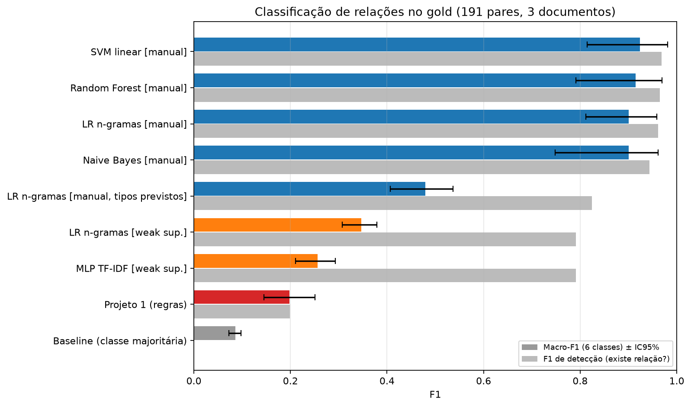
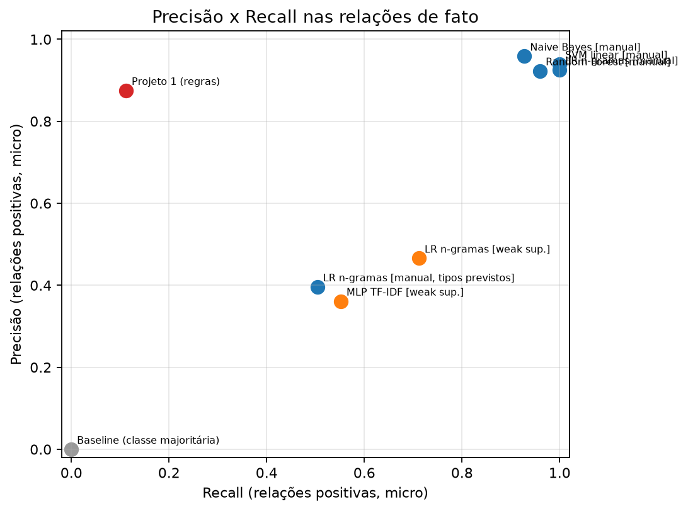
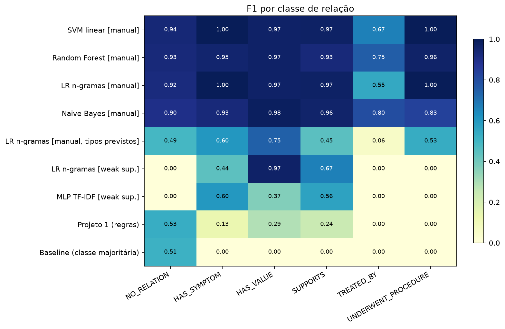
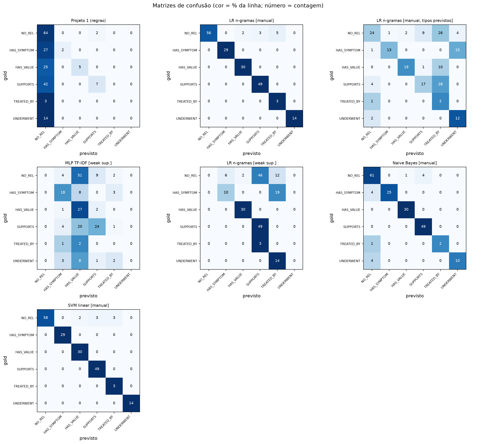
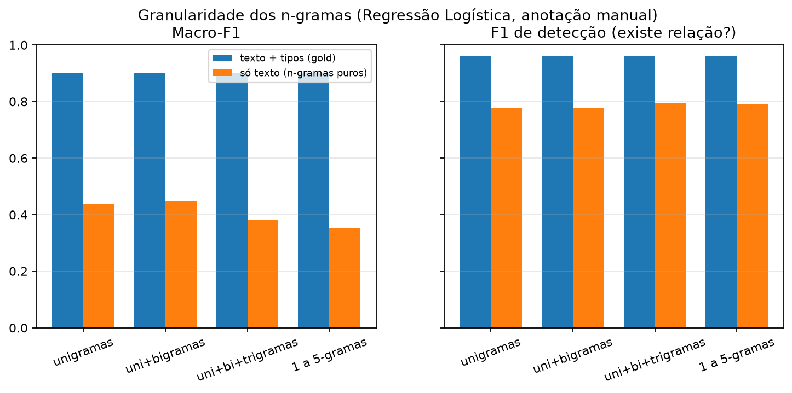
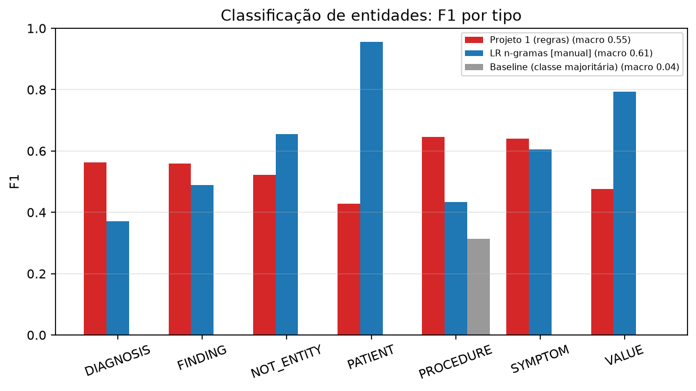
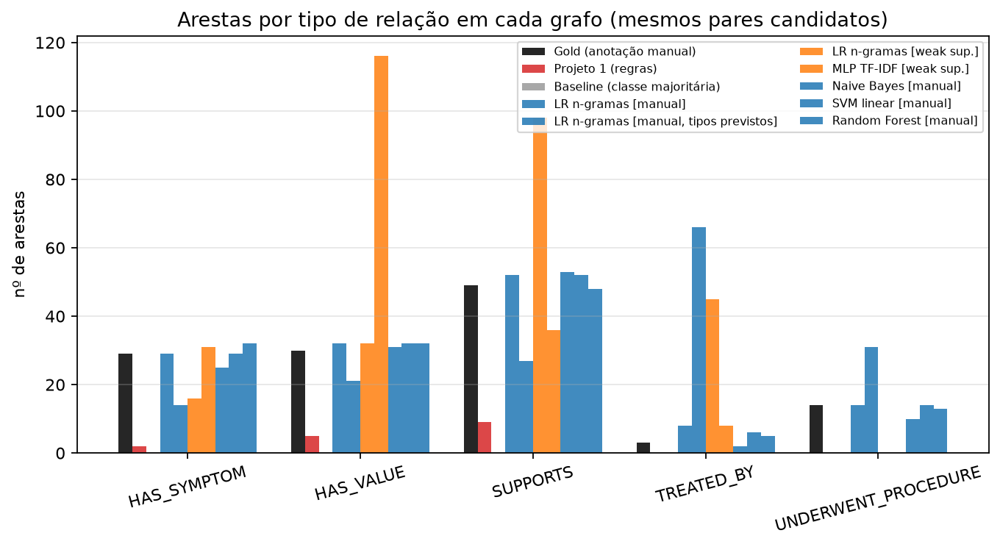
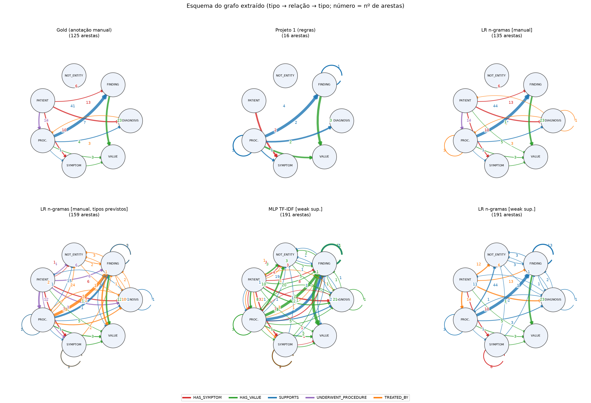

# Comparação Projeto 1 (regras) × Projeto 2 (N-gramas + ML)

_Gerado automaticamente por `python -m src.comparison.run_comparison` (seed=42)._

## 1. Configuração experimental

- **Teste (gold)**: 191 pares candidatos em 3 documentos (PMC11131390_01, PMC11722600_01, PMC3859158_01), nunca usados no treino manual.
- **Treino manual**: `data/annotations/text01..12.csv`. **Weak supervision**: arestas do Projeto 1 (`data/processed/edges.csv`) sem os documentos gold.
- **Lematizador usado**: `en_core_web_sm`. **MLP**: 75 épocas, melhor loss de treino 0.0040, classes ['HAS_SYMPTOM', 'HAS_VALUE', 'SUPPORTS', 'TREATED_BY'].
- Tarefa de relações avaliada sobre os **pares candidatos do gold**. Os modelos marcados `[manual]` recebem os **tipos de entidade do gold (oráculo)**; a variante `tipos previstos` usa o EntityClassifier. O Projeto 1 é lido da sua saída oficial, com casamento relaxado de menções (favorece o P1) e **sem** receber tipos prontos.
- Pares com uma entidade `NOT_ENTITY` são sempre `NO_RELATION`: com tipos do gold isso é fácil para o ML (inflaciona a classe `NO_RELATION`).

## 2. Observações automáticas

- Melhor macro-F1 de relações: **SVM linear [manual]** (0.923); Projeto 1 = 0.198; melhor modelo de ML = **SVM linear [manual]** (0.923).
- Projeto 1 detecta 11% dos pares realmente relacionados no gold (recall de detecção), com precisão de detecção 88%.
- `LR n-gramas [weak sup.]` nunca prevê: NO_RELATION, UNDERWENT_PROCEDURE.
- `MLP TF-IDF [weak sup.]` nunca prevê: NO_RELATION, UNDERWENT_PROCEDURE.
- `Projeto 1 (regras)` nunca prevê: TREATED_BY, UNDERWENT_PROCEDURE.
- Mesmo modelo (LR + n-gramas), fonte de rótulos diferente: anotação manual supera a weak supervision em 0.554 de macro-F1 — isola o efeito da supervisão.
- Ablação de n-gramas (só texto): melhor = **uni+bigramas** (0.450), pior = 1 a 5-gramas (0.350).
- Ablação de n-gramas (texto + tipos do gold): praticamente sem diferença entre granularidades (amplitude 0.000).
- Sem o oráculo de tipos (tipos previstos pelo EntityClassifier), o LR cai de 0.900 para 0.480 de macro-F1 — comparação mais justa com o Projeto 1, que não recebe tipos prontos.
- Entidades: cobertura do Projeto 1 sobre as menções reais do gold = 81% (casamento relaxado).
- Intervalos de confiança largos (gold pequeno): diferenças menores que a largura do IC **não** são conclusivas.

## 3. Relações — resumo por modelo

| modelo | familia | supervisao | accuracy | macro_f1 | macro_f1_ic95_inf | macro_f1_ic95_sup | weighted_f1 | pos_micro_precision | pos_micro_recall | pos_micro_f1 | detect_f1 | typing_accuracy_on_gold_positives |
|---|---|---|---|---|---|---|---|---|---|---|---|---|
| SVM linear [manual] | SVM | Anotação manual (12 docs) | 0.958 | 0.923 | 0.814 | 0.981 | 0.960 | 0.940 | 1.000 | 0.969 | 0.969 | 1.000 |
| Random Forest [manual] | Random Forest | Anotação manual (12 docs) | 0.937 | 0.915 | 0.791 | 0.969 | 0.938 | 0.923 | 0.960 | 0.941 | 0.965 | 0.960 |
| LR n-gramas [manual] | Regressão Logística | Anotação manual (12 docs) | 0.948 | 0.900 | 0.811 | 0.959 | 0.952 | 0.926 | 1.000 | 0.962 | 0.962 | 1.000 |
| Naive Bayes [manual] | Naive Bayes | Anotação manual (12 docs) | 0.927 | 0.900 | 0.749 | 0.961 | 0.925 | 0.959 | 0.928 | 0.943 | 0.943 | 0.928 |
| LR n-gramas [manual, tipos previstos] | Regressão Logística | Anotação manual (12 docs) | 0.455 | 0.480 | 0.407 | 0.537 | 0.533 | 0.396 | 0.504 | 0.444 | 0.824 | 0.504 |
| LR n-gramas [weak sup.] | Regressão Logística | Regras do P1 (weak supervision) | 0.466 | 0.346 | 0.307 | 0.379 | 0.391 | 0.466 | 0.712 | 0.563 | 0.791 | 0.712 |
| MLP TF-IDF [weak sup.] | MLP (PyTorch) | Regras do P1 (weak supervision) | 0.361 | 0.256 | 0.211 | 0.293 | 0.294 | 0.361 | 0.552 | 0.437 | 0.791 | 0.552 |
| Projeto 1 (regras) | Regras (verbos/distância) | Regras escritas à mão | 0.408 | 0.198 | 0.145 | 0.250 | 0.310 | 0.875 | 0.112 | 0.199 | 0.199 | 0.112 |
| Baseline (classe majoritária) | Dummy | Anotação manual | 0.346 | 0.086 | 0.072 | 0.098 | 0.177 | 0.000 | 0.000 | 0.000 | 0.000 | 0.000 |

## 4. Relações — F1 por classe

| modelo | NO_RELATION | HAS_SYMPTOM | HAS_VALUE | SUPPORTS | TREATED_BY | UNDERWENT_PROCEDURE |
|---|---|---|---|---|---|---|
| SVM linear [manual] | 0.935 | 1.000 | 0.968 | 0.970 | 0.667 | 1.000 |
| Random Forest [manual] | 0.929 | 0.951 | 0.968 | 0.928 | 0.750 | 0.963 |
| LR n-gramas [manual] | 0.918 | 1.000 | 0.968 | 0.970 | 0.545 | 1.000 |
| Naive Bayes [manual] | 0.897 | 0.926 | 0.984 | 0.961 | 0.800 | 0.833 |
| LR n-gramas [manual, tipos previstos] | 0.490 | 0.605 | 0.745 | 0.447 | 0.058 | 0.533 |
| LR n-gramas [weak sup.] | 0.000 | 0.444 | 0.968 | 0.667 | 0.000 | 0.000 |
| MLP TF-IDF [weak sup.] | 0.000 | 0.600 | 0.370 | 0.565 | 0.000 | 0.000 |
| Projeto 1 (regras) | 0.531 | 0.129 | 0.286 | 0.241 | 0.000 | 0.000 |
| Baseline (classe majoritária) | 0.514 | 0.000 | 0.000 | 0.000 | 0.000 | 0.000 |

## 5. Ablação de n-gramas (Regressão Logística, anotação manual)

| granularidade | macro_f1_com_tipos | detect_f1_com_tipos | accuracy_com_tipos | macro_f1_so_texto | detect_f1_so_texto | accuracy_so_texto |
|---|---|---|---|---|---|---|
| unigramas | 0.900 | 0.962 | 0.948 | 0.436 | 0.777 | 0.529 |
| uni+bigramas | 0.900 | 0.962 | 0.948 | 0.450 | 0.779 | 0.534 |
| uni+bi+trigramas | 0.900 | 0.962 | 0.948 | 0.380 | 0.795 | 0.450 |
| 1 a 5-gramas | 0.900 | 0.962 | 0.948 | 0.350 | 0.791 | 0.414 |

## 6. Entidades (classificação do tipo da menção)

| modelo | accuracy | macro_f1 | tipos_micro_precisao | tipos_micro_recall | tipos_micro_f1 |
|---|---|---|---|---|---|
| LR n-gramas [manual] | 0.552 | 0.615 | 0.528 | 0.547 | 0.537 |
| Projeto 1 (regras) | 0.557 | 0.548 | 0.619 | 0.521 | 0.566 |
| Baseline (classe majoritária) | 0.186 | 0.045 | 0.186 | 0.216 | 0.200 |

## 7. Grafo resultante (mesmos pares candidatos)

| metodo | arestas | nos | grau_medio | densidade_media | tipos_de_relacao | triplas_de_esquema | arestas_corretas (tipo+par) | arestas_em_excesso | arestas_perdidas | jaccard_esquema_vs_gold |
|---|---|---|---|---|---|---|---|---|---|---|
| Gold (anotação manual) | 125 | 156 | 1.603 | 0.016 | 5 | 11 | 125 | 0 | 0 | 1.000 |
| Projeto 1 (regras) | 16 | 31 | 1.032 | 0.084 | 3 | 8 | 14 | 2 | 111 | 0.462 |
| Baseline (classe majoritária) | 0 | 0 | 0.000 | 0.000 | 0 | 0 | 0 | 0 | 125 | 0.000 |
| LR n-gramas [manual] | 135 | 163 | 1.656 | 0.015 | 5 | 15 | 125 | 10 | 0 | 0.733 |
| LR n-gramas [manual, tipos previstos] | 159 | 189 | 1.683 | 0.014 | 5 | 37 | 63 | 95 | 62 | 0.263 |
| LR n-gramas [weak sup.] | 191 | 219 | 1.744 | 0.012 | 4 | 27 | 89 | 101 | 36 | 0.226 |
| MLP TF-IDF [weak sup.] | 191 | 219 | 1.744 | 0.012 | 4 | 49 | 69 | 122 | 56 | 0.154 |
| Naive Bayes [manual] | 121 | 156 | 1.551 | 0.015 | 5 | 12 | 116 | 5 | 9 | 0.917 |
| SVM linear [manual] | 133 | 161 | 1.652 | 0.016 | 5 | 14 | 125 | 8 | 0 | 0.786 |
| Random Forest [manual] | 130 | 159 | 1.635 | 0.016 | 5 | 15 | 120 | 10 | 5 | 0.733 |

### Projeto 1 ponta a ponta (todas as arestas do P1 nos documentos gold, mundo fechado)

| avaliacao | arestas_P1 | arestas_gold | precisao | recall | f1 |
|---|---|---|---|---|---|
| sem tipo (só existência) | 34 | 125 | 0.441 | 0.112 | 0.179 |
| com tipo da relação | 34 | 125 | 0.441 | 0.112 | 0.179 |

_O gold não é exaustivo: a precisão ponta a ponta tende a ser subestimada._

### Arestas do Projeto 1 no corpus inteiro, por relação

| relation_label | arestas_P1_corpus_inteiro |
|---|---|
| SUPPORTS | 272 |
| HAS_VALUE | 195 |
| TREATED_BY | 148 |
| HAS_SYMPTOM | 39 |

## 8. Figuras

